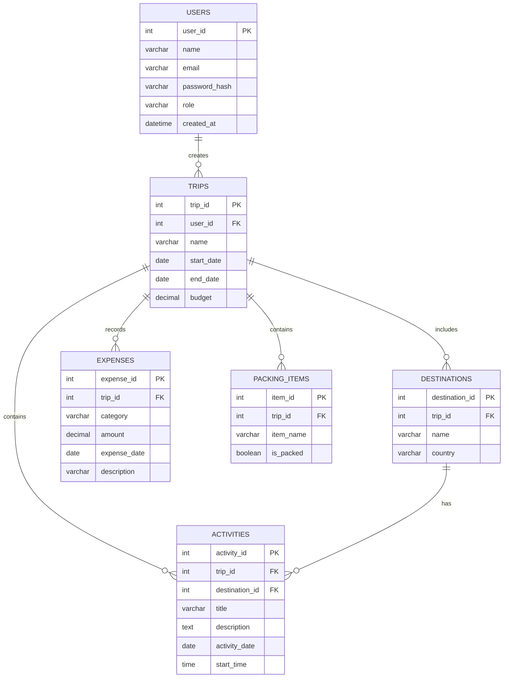

# TripMate Entity-Relationship Diagram

This document describes the planned relational database for TripMate, a travel planner that helps users organize trips, destinations, daily activities, expenses, and packing lists.

## Entity relationship diagram

## Entities

### `users`

Stores registered user accounts and their access roles.

| Column | Key | Description |
|---|---|---|
| `user_id` | PK | Unique user identifier. |
| `name` | | User's display name. |
| `email` | | User's email address; should be unique. |
| `password_hash` | | Securely hashed password. |
| `role` | | User role, such as `admin` or `user`. |
| `created_at` | | Date and time the account was created. |

### `trips`

Stores trips created by users.

| Column | Key | Description |
|---|---|---|
| `trip_id` | PK | Unique trip identifier. |
| `user_id` | FK → `users.user_id` | User who owns the trip. |
| `name` | | Name of the trip. |
| `start_date` | | Trip starting date. |
| `end_date` | | Trip ending date. |
| `budget` | | Planned budget for the trip. |

### `destinations`

Stores destinations included in a trip.

| Column | Key | Description |
|---|---|---|
| `destination_id` | PK | Unique destination identifier. |
| `trip_id` | FK → `trips.trip_id` | Trip to which the destination belongs. |
| `name` | | Name of the destination. |
| `country` | | Country where the destination is located. |

### `activities`

Stores activities planned as part of a trip's daily itinerary.

| Column | Key | Description |
|---|---|---|
| `activity_id` | PK | Unique activity identifier. |
| `trip_id` | FK → `trips.trip_id` | Trip containing the activity. |
| `destination_id` | FK → `destinations.destination_id` | Destination where the activity takes place. |
| `title` | | Activity name. |
| `description` | | Details about the activity. |
| `activity_date` | | Date of the planned activity. |
| `start_time` | | Planned starting time. |

### `expenses`

Stores expenses associated with a trip.

| Column | Key | Description |
|---|---|---|
| `expense_id` | PK | Unique expense identifier. |
| `trip_id` | FK → `trips.trip_id` | Trip associated with the expense. |
| `category` | | Expense category, such as transport, food, or accommodation. |
| `amount` | | Amount spent. |
| `expense_date` | | Date the expense occurred. |
| `description` | | Additional expense details. |

### `packing_items`

Stores items users need to pack for a trip and whether they have packed them.

| Column | Key | Description |
|---|---|---|
| `item_id` | PK | Unique packing-item identifier. |
| `trip_id` | FK → `trips.trip_id` | Trip associated with the packing item. |
| `item_name` | | Name of the item. |
| `is_packed` | | Indicates whether the item has been packed. |

## Relationships and cardinality

- **Users → Trips:** One user can create zero or many trips. Each trip belongs to one user.
- **Trips → Destinations:** One trip can include zero or many destinations. Each destination belongs to one trip.
- **Trips → Activities:** One trip can contain zero or many activities. Each activity belongs to one trip.
- **Destinations → Activities:** One destination can have zero or many activities. Each activity is associated with one destination.
- **Trips → Expenses:** One trip can have zero or many expenses. Each expense belongs to one trip.
- **Trips → Packing Items:** One trip can have zero or many packing items. Each packing item belongs to one trip.

## Integrity rules

1. Each primary key must uniquely identify a record.
2. Each foreign key must reference an existing record in its related table.
3. User email addresses should be unique.
4. Passwords must be stored as secure hashes, not plain text.
5. Trip end dates must not be earlier than their start dates.
6. Expense amounts and trip budgets must not be negative.
7. The `is_packed` field must represent either packed or not packed.

## Scope assumptions

- Each trip belongs to one user.
- Each destination belongs to one trip.
- Each activity belongs to one trip and one destination.
- Expenses and packing items are associated with individual trips.
- Weather information will be retrieved from an external weather API and does not require a separate database entity for this initial draft.
- This document represents the planned database schema. The actual MySQL tables will be implemented in a later development stage.
